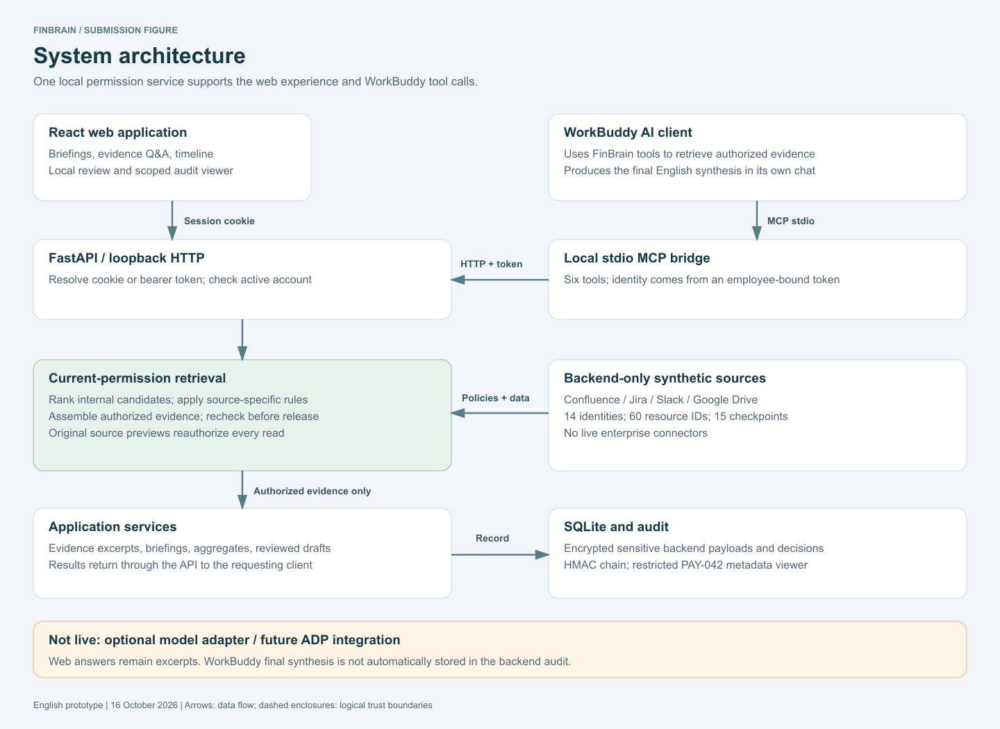
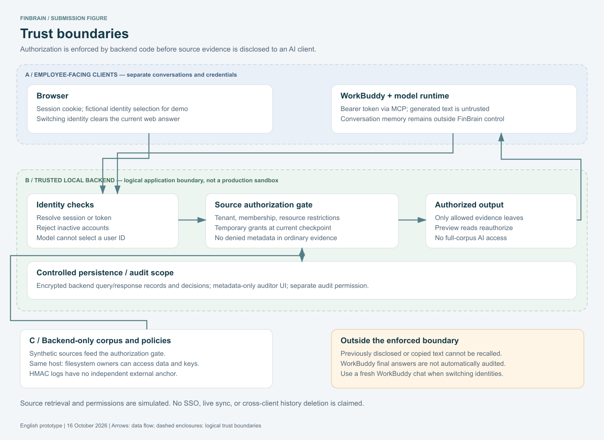

# FinBrain — The Internal Brain

Permission-aware enterprise knowledge, with cited answers and auditability.

English local prototype for the Aspire / FinTech challenge at the Tencent Cloud AI CAN DO IT Hackathon Singapore 2026. FinBrain combines a web workspace with six WorkBuddy MCP tools over a shared authorization service.

**Current demo:** the website returns local evidence excerpts; WorkBuddy uses the tools to generate AI summaries. No model API key is needed to run the website. WorkBuddy requires its own account and available credits. Live web-model integration and ADP are not configured. All business data is synthetic; there are no live Confluence, Jira, Slack, or Drive connectors.



## Quick start — Windows PowerShell

Prerequisites: Python **3.11 or newer**, Git (or download the repository ZIP), and Internet access for the first dependency installation. The English web build is included, so Node.js is not needed just to run the demo.

```powershell
git clone https://github.com/yangfengshun19/Finbrain.git
cd Finbrain
python -m venv .venv
.\.venv\Scripts\python.exe -m pip install -r finbrain\requirements-lock.txt
cd finbrain
..\.venv\Scripts\python.exe run.py
```

If `python` is not recognized but the Windows Python launcher is installed, use `py -3 -m venv .venv` for the environment-creation step. These commands do not require activation scripts or changes to PowerShell execution policy.

Open **http://127.0.0.1:8765**. Keep the terminal running. Press **Ctrl+C** to stop the server. For later starts, run the final two commands from the repository root. The server creates `finbrain/runtime/` automatically; it is intentionally not committed.

`requirements-lock.txt` pins the full dependency set verified on Windows/Python 3.12. The direct dependency manifest remains `requirements.txt`. Other supported environments should be tested before distribution.

Keep `finbrain/` and `finbrain_mock/` as sibling folders. Do not open `frontend/dist/index.html` directly: the UI requires the backend.

## macOS / Linux

```bash
git clone https://github.com/yangfengshun19/Finbrain.git
cd Finbrain
python3 -m venv .venv
.venv/bin/python -m pip install -r finbrain/requirements-lock.txt
cd finbrain
../.venv/bin/python run.py
```

These are equivalent startup instructions; the release verification was performed on Windows, not macOS/Linux.

## First walkthrough

The slider icon at the top right opens the demo console. Identity selection is a local testing control, not enterprise authentication. Timeline checkpoints affect all sessions.

1. Choose **Alice / T10**. View **My briefing**, then ask **What caused PAY-042, and has the fix been deployed?** in **Evidence Q&A**. The webpage labels its output as local excerpts.
2. Choose **Alice / T06** and ask **SL16**. Compare with **Ben / T06**: the restricted evidence must not be returned to Ben.
3. Choose **Chloe / T04**, ask **CF01**, then advance to **T12** and repeat. The temporary grant has expired.
4. Choose **Karen** and open **Access audit** to inspect the PAY-042 metadata view. This is not a full query/answer reconstruction UI.

Detailed scenarios: [User guide](USER_GUIDE.md). Project narrative: [English description](docs/submission/PROJECT_DESCRIPTION_EN.md).

## Connect WorkBuddy through MCP

Keep the web server running. Select the intended employee in the web console. Open **Connect WorkBuddy**, click **Generate my tool token**, then **Copy token**.

In WorkBuddy's MCP/custom connector settings, merge the following configuration into your existing `mcpServers` object. Replace both absolute paths with the location of your clone. The repository-root virtual environment is used below.

```json
{
  "mcpServers": {
    "finbrain": {
      "command": "C:/path/to/Finbrain/.venv/Scripts/python.exe",
      "args": ["C:/path/to/Finbrain/finbrain/mcp_bridge.py"],
      "env": {
        "FINBRAIN_URL": "http://127.0.0.1:8765",
        "FINBRAIN_TOKEN": "PASTE_CURRENT_EMPLOYEE_TOKEN_LOCALLY"
      }
    }
  }
}
```

On macOS/Linux, use the absolute `.venv/bin/python` path. The MCP bridge uses only Python's standard library. Save, enable/reconnect the connector, and confirm that six tools are available. In a fresh WorkBuddy conversation, ask:

> Use FinBrain get_my_briefing and ask_knowledge to explain what needs my attention and what caused PAY-042. Answer in English and cite only returned evidence. Distinguish hypotheses, confirmed causes, merges, and deployments. State evidence gaps. Do not read local project files or use other connectors for enterprise evidence.

**Identity matters:** tokens are bound to an employee and expire after eight hours. Switching the website identity does not update WorkBuddy's token. To switch employees, generate a new token, update the local connector configuration, reconnect, and start a fresh conversation. For a revocation test, keep Chloe's token unchanged while advancing from T04 to T12. Previously seen WorkBuddy conversation content cannot be erased by FinBrain.

Do not commit actual tokens or screenshots containing them. MCP integration does not enable AI generation inside the website, and WorkBuddy's final synthesized response is not automatically captured by the backend audit.

## Run verification

From the repository root, using the environment created above:

```powershell
.\.venv\Scripts\python.exe finbrain\test.py
.\.venv\Scripts\python.exe -m unittest discover -s finbrain_mock -p "test_*.py" -v
```

With a separate demo server running, exercise the real MCP process:

```powershell
.\.venv\Scripts\python.exe finbrain\scripts\smoke_mcp.py
```

The smoke script creates a Ben demo session and performs tool queries; use a test runtime because it adds local query/audit records. See [repository verification](docs/REPOSITORY_VERIFICATION.md) for the checks actually executed on this release.

## Frontend development

Use Node.js **22.12+** and pnpm **10**. The committed lockfile provides the resolved frontend dependencies.

```powershell
cd finbrain\frontend
pnpm install --frozen-lockfile
pnpm run build
```

If pnpm reports a blocked esbuild install script, run `pnpm approve-builds`, approve **esbuild**, and retry the build. `pnpm dev` runs a development UI that proxies `/api` to port 8765. Backend Python changes require restarting `run.py`.

## Optional remote model

The default is offline excerpts. To use the existing Chat Completions adapter, copy `finbrain/.env.example` to `finbrain/.env`, then supply your own HTTPS endpoint, model name, and key, and set `FINBRAIN_ANSWER_MODE=remote`. Restart the server. A successful answer is labelled **AI synthesis**; invalid configuration, failed calls, or rejected citations fall back to excerpts. Merely setting the variables is not proof of a live connection. ADP uses a different API and needs a separate adapter, not just an endpoint substitution.

## Troubleshooting

| Symptom | Action |
|---|---|
| Missing `fastapi`, `uvicorn`, or another module | Install requirements using the same `.venv` interpreter used for startup. |
| Port 8765 is occupied | Use the existing FinBrain instance if it is yours, or set `$env:FINBRAIN_PORT="8766"` before starting. Update the browser URL and `FINBRAIN_URL` in MCP to match. Do not stop unknown processes. |
| WorkBuddy lists tools but calls fail | Check the backend is running, token is current, and the configured paths exist. Reconnect after edits. |
| MCP still acts as the previous employee | Replace its token and reconnect; changing the web identity alone is insufficient. |
| Existing database has no local key | Restore its matching key. For a disposable demo, stop the server and rename the entire runtime folder as a backup, then restart. Never create a replacement key for an existing encrypted database. |
| Browser shows an older UI | Confirm the server directory and hard-refresh the browser. |

## Boundaries and repository contents



The server listens on loopback. Local identity switching, same-machine key storage, and synthetic policy replay make this a demo, not a production enterprise deployment. Do not publicly expose this server. The HMAC audit chain lacks an independent external anchor and cannot detect every tail deletion. Published knowledge-demand aggregates are thresholded, not formally anonymous. Current permission checks govern subsequent reads, not information already disclosed.

Source code, the synthetic dataset, prebuilt English UI, and submission diagrams are included. Credentials, local runtime databases, dependency binaries, private group chats, competition handbooks, and third-party training PDFs are excluded. Historical verification is in [ENGLISH_PACKAGE_VALIDATION.md](ENGLISH_PACKAGE_VALIDATION.md); it is distinct from this repository's fresh checks. No new open-source license is asserted by this upload.
