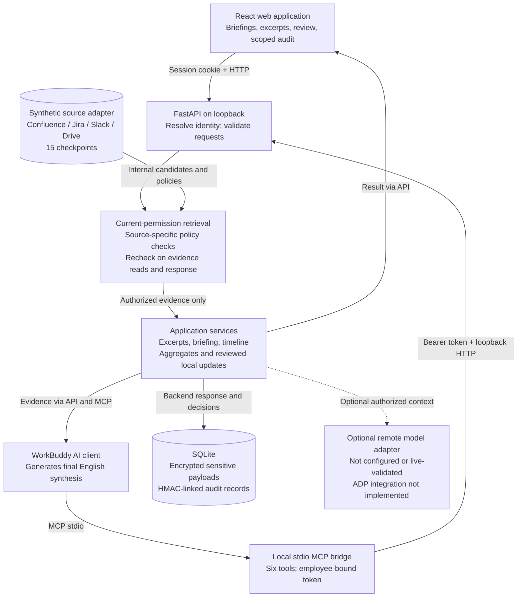
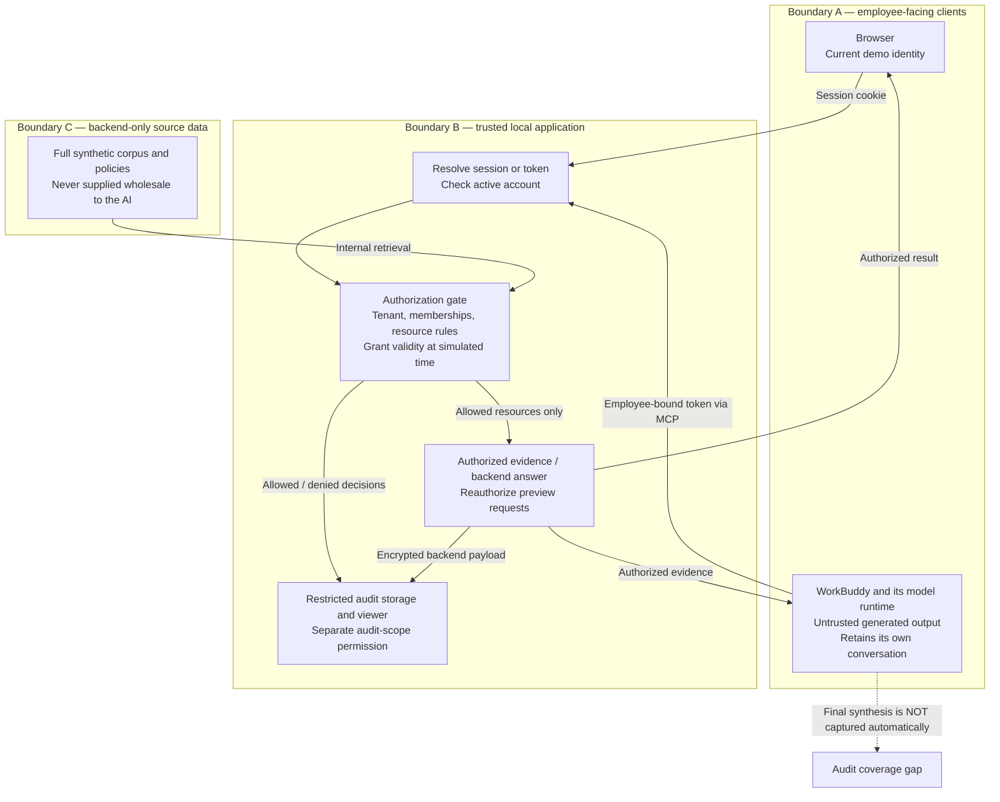

# FinBrain — editable diagram sources

## Architecture: current English prototype

## Trust boundaries: authority and data exposure

The source-data and backend boxes are logical boundaries on one machine, not separate OS sandboxes. The filesystem owner can access the dataset, database, and local key. Demo identity selection is not SSO. Denied document metadata is excluded from ordinary evidence responses. Revocation governs new reads, not already disclosed information or WorkBuddy memory. Optional remote-adapter citation checks validate IDs, not the truth of generated statements.
